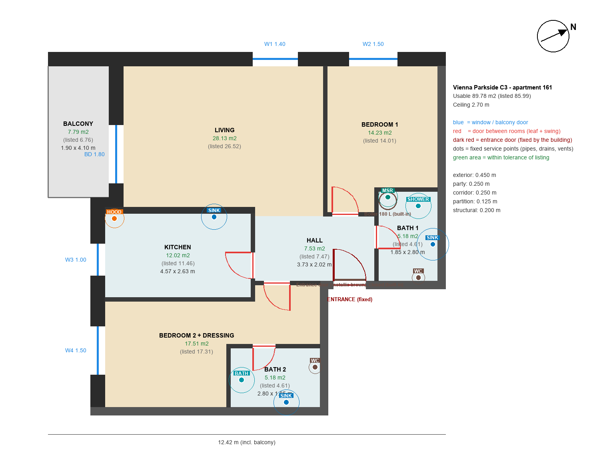

# Apartment 161 — Vienna Parkside C3 (Bucharest)

3D model and interior design workspace for a 3-room apartment, built in **Blender 5.2** from a
single data file and driven with **Claude Code**.



## Iteration 2 (current): furniture variants
The shell is done: rooms, walls (45 cm exterior / 25 cm neighbour / 12.5 cm interior), windows,
doors with their swing, balcony, ceiling at 2.70 m, and real sun for any date/time at the
apartment's location and orientation. Furniture comes in **variants**, one file each in
`data/variants/`. Every piece has a readable id like `A.sofa-living-1`. Variant A is empty for now.

| Room | Area (model) | Listed |
|---|---|---|
| Living | 26.52 | 26.52 |
| Kitchen | 11.46 | 11.46 |
| Bedroom 1 | 14.01 | 14.01 |
| Bedroom 2 + dressing | 17.31 | 13.53 + 3.78 |
| Bath 1 / Bath 2 | 4.61 / 4.61 | 4.61 / 4.61 |
| Hall | 7.61 | 7.47 |
| Balcony | 6.76 | 6.76 |

Facade A (living, bedroom 1) faces **WNW** - evening sun. Facade B (balcony, kitchen,
bedroom 2) faces **SSW** - midday/afternoon sun.

## Quick start
```powershell
uv sync                         # once
uv run apartment build          # generates models/apartment.blend
uv run apartment open           # opens it in Blender
```
In Blender press **N** → tab **Apartment**:
- **Top-down plan**: looks straight down. The ceiling becomes invisible but still casts sun shadows.
- **3D overview**: a view from above.
- **Rooms**: 🏠 jumps to the room at eye height · 🎨 starts *walk mode* (WASD + mouse,
  Esc to exit) · 📷 looks through that room's camera.
- **Sun study**: day/month/year + time slider, solstice/equinox buttons, "Now".
  Switch the viewport to *Rendered* shading (Z key → Rendered) for the most accurate light.
  *Set up day animation* turns the timeline into a 06:00 → 21:00 day: scrub or press Space.

## Furniture variants and ids
- Blender → N → **Apartment → Furniture variants**: ◀ **A B C** ▶ switches the variant without
  moving your view. **Show IDs** puts each piece's id above it. Click a piece and press
  **Copy id** to paste it to Claude: *"move A.sofa-living-1 30 cm towards the window"*.
- `uv run apartment plan --variant A` → `docs/variants/A.png`: a 2D plan with every id.
- `uv run apartment variant new B --from A --name "Scandi light"` copies A into a new variant B
  with its own ids (`B.sofa-living-1`...).
- `uv run apartment render --variant B --views plan,living` renders a variant.
- Variant **DEV** ("Real estate developer schema") is the developer's furnished render, rebuilt.

## Storage you can open, fixed pipes
- **Apartment → Storage**: click a wardrobe/cabinet → *Open / close selected* (or *Open all*).
  *Show doors & drawer fronts* off = see inside every cabinet. Click a door → *Copy module id*
  (`DEV.wardrobe-living-1/m2`, m1 = leftmost) and tell Claude *"3 shelves and a rail in …/m2"*.
- **Fixed points** (dots on the plan: SINK, WC, MSR = washing machine, HOOD, SHOWER/BATH) are
  where the building's pipes and vents are. Every variant must keep a sink/WC/washer/hood on
  them - `uv run apartment validate` fails otherwise. Red lines = doors, dark red = fixed entrance.
- **Lights**: fixtures (ceiling lights, pendants, lamps) are furniture with ids that really light
  the scene. *Lights on* (Furniture variants box) switches them; renders turn them on at dusk
  (`--lights auto|on|off`), e.g. `uv run apartment render --variant DEV --time "2026-12-21 19:00"`.

## Changing the apartment
Edit `data/apartment.toml` (or ask Claude: *"the living room is 6.42 m wide, I measured it"*),
then `uv run apartment validate` and `uv run apartment build`. Don't edit the .blend by hand.
It is regenerated each build.

## Useful commands
```powershell
uv run apartment plan --sun "2026-12-21 13:00"        # 2D plan PNG with sun direction
uv run apartment sun "2026-12-21 13:00"               # sun angles + which facades get sun
uv run apartment render --views plan,living --time "2026-06-21 18:00"
uv run apartment render --views living --engine cycles --samples 128   # physically accurate
uv run apartment sun-study --date 2026-12-21 --views plan --step 60    # one image per hour
uv run pytest                                         # tests
```

## Blender MCP (Claude controls your open Blender)
1. `uv run apartment install-addon` (done once; also turns the MCP add-on's telemetry off).
2. In Blender: N → **BlenderMCP** → *Connect to MCP server*.
3. In Claude Code run `/mcp` and approve the project server **blender**.
Claude can then look at your viewport and help interactively. Lasting changes still go to
`data/apartment.toml`.

## Project layout
See [CLAUDE.md](CLAUDE.md) (agent guide) and [docs/decisions](docs/decisions) (why every
number is what it is).

## Limitations
Dimensions are reconstructed from the developer's render + listed areas (see ADR 0001).
Measure on site to confirm. The sun simulation ignores neighbouring buildings and trees.
